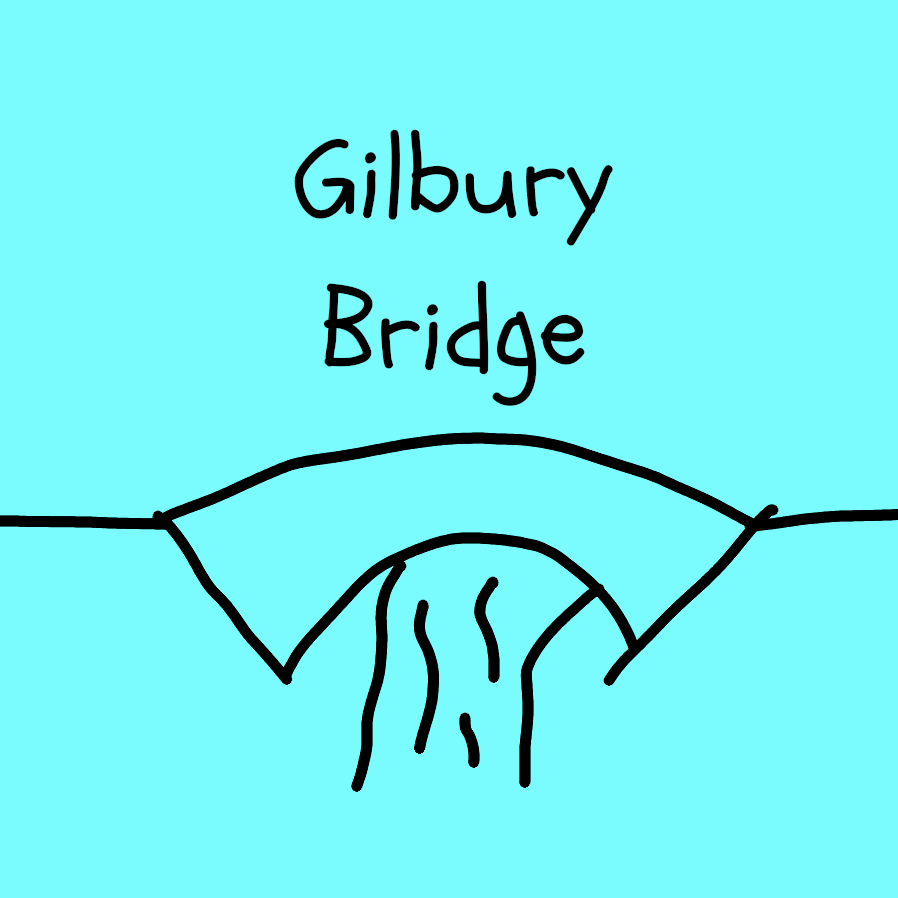

# Bridge

Once all the East locations have been entered at least once use the below location as the next location to add to the map.

## Gilbury Bridge {.h2centre}

```{=html}
<style>
.add-space{
padding-right: 2%;
}
</style>
```

::::: columns
::: {.column .add-space width="34%"}

:::

::: {.column width="64%"}
A stone walking bridge is guarded by a massive goat. Below it where a road once was is a deep fast flowing river that will devour any who try to cross it, the danger is immediately obvious.

\- The Massive goat (Massive Billy Goat Gruff) can surprisingly speak and will demand the toll of a rotary phone to pass.

\- The E exit can only lead to/from East locations.

\- The W exit can only lead to/from West locations.
:::
:::::

### Massive Billy Goat Gruff

**STR**: 14 **DEX**: 14 **CTRL**: 10<br> **HP**: 6

Ram (d8)

- A massive talking goat
- Guards a bridge requiring a toll to pass
- Although it will not let anyone pass without the toll it is surprisingly helpful