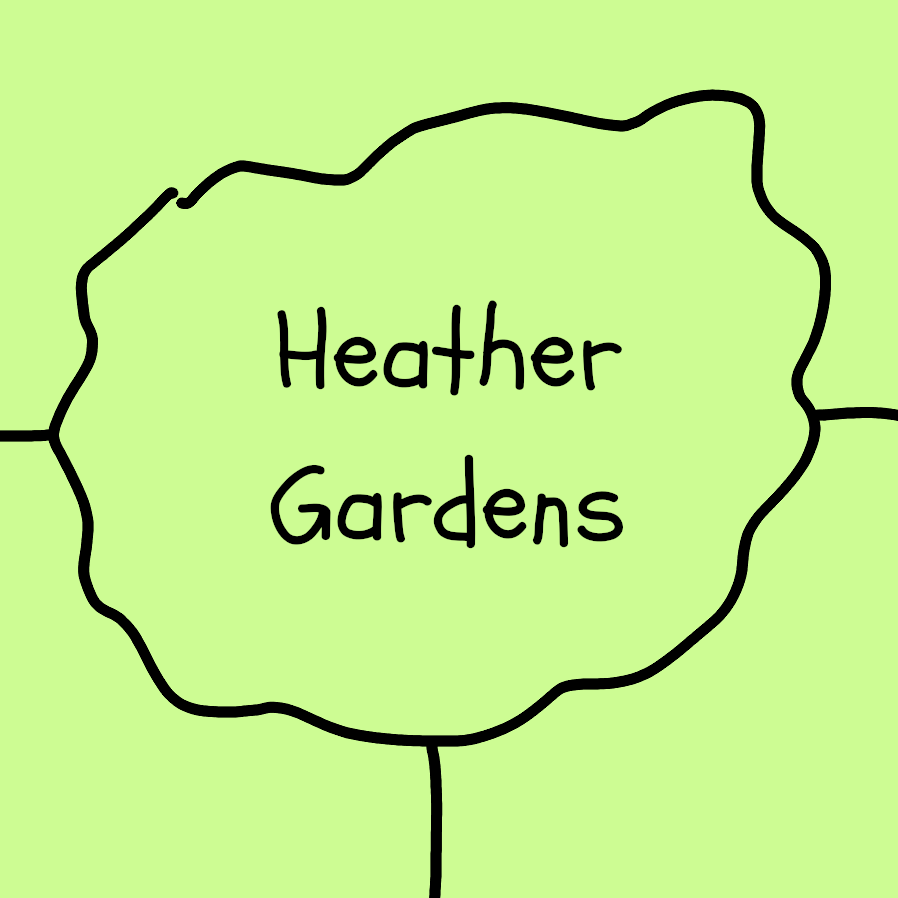
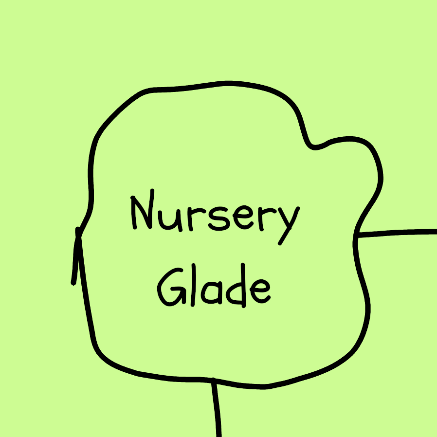

# East locations

The 10 east locations are included within the sticky pool at the start of this [sticky crawl](/sticky_crawl/sticky_crawl.qmd).

The focus of this mystery is on the investigator's interactions with [The Guillotined](/the_toll_of_unmeaning/the_guillotined.qmd). Therefore, the descriptions of the locations are deliberately sparse. The facilitator is free to expand these in prep or during play.

East locations cannot directly connect to [West locations](/the_toll_of_unmeaning/west_locations.qmd). The East and West are only connected by [Gilbury Bridge](/the_toll_of_unmeaning/bridge.qmd).

## (1) Heather Gardens {.h2centre}

Vibrant purple shrubs lie still in the calm.
An enveloping aroma of heather creates a homely vibe.

- Those that rest here heal 1 CTRL (max once). After the rest the investigator can no longer smell any and all heather.

## (2) Herbaceous Garden {.h2centre}

Where there was once herbs, now poppies of red, purple, yellow, and white have conquered the land. The poppies move together as if they share the same dream.

- Those who haphazardly walk through will find themselves falling asleep (STR save to avoid sleep).
- Each and every unattended sleeping investigator will have one of their items stolen by [Rotary Phone Head](/the_toll_of_unmeaning/the_guillotined.qmd#rotary-phone-head) (if alive and activated).

## (3) Iris Garden {.h2centre}

A perfect circular garden of irises.
In the centre the flowers are an all consuming black, made darker by the encircling yellow, orange, and red.

- Slowly the irses will turn to follow the investigators.
- Each investigator will get the strong urge to look at them. Those who do make a CTRL save.
  - Those who failed will have their vision reversed. Their irises will look into their eyes instead of outwards (1d4 dex damage).
  - Vision will mostly return to normal once they leave the iris garden.

## (4) The Park {.h2centre}

{width="500"}

A large open space of grass with scatterings of trees. 
A darkness you've never known before descends from the sky.
No stars, no moon, no light fills the void.

- For those who watch the sky they will hear the sound of a bell come from space.
- It will ring 7 times, each time a new star appears forming a constellation in the shape of a bell. Those who hear all seven rings suffer 1 stress.

## (5) Nursery Glade {.h2centre}

The shrill of a screaming baby reaches out from the centre of the flower nursery.
Its emitter shrouded by the quivering flower buds.

- The source is a fox, its fur replaced by red petals (1d4 stress).
- When approached it will run off screaming whilst leaving a trail of petals.
- If followed it will be found being strangled by [Rotary Phone Head](/the_toll_of_unmeaning/the_guillotined.qmd#rotary-phone-head) (if alive and activated).

## (6) Oxbury House {.h2centre}

A grainy cacophony loudly blares out from the 13th century Manor house. 
It only becomes louder and more disorienting as it reverberates within its maze like halls.

- How do the investigators intend to traverse the large house?
- The walls are covered with the portraits of bell-headed gentry.
- [Gramophone Head](/the_toll_of_unmeaning/the_guillotined.qmd#gramophone-head) can be found alone in a massive ballroom attempting to drink whiskey and smoke a cigar as their gramophone lets out the horrendous dirge.

## (7) Rare Space Garden {.h2centre}

Clean geometric flat stones lead a path through this highly manicured garden.

A lovely space for individuals with dementia to relax in the gardens.

- Posters describe the award winning garden and how it benefits individuals diagnosed with rare dementias.
- [Rotary Phone Head](/the_toll_of_unmeaning/the_guillotined.qmd) sits on a bench waiting in the shadows. With a rustle they will quickly hide when investigators approach.
  - From then on Rotary phone head is activated and will stalk the investigators, attempting to ambush any isolated investigators.
  - The bench he sits on is dedicated to his wife Cherry.

## (8) Sakura Cherry Garden {.h2centre}

A solemn location where cherry blossom petals slowly but constantly fall.

- As each petal hits the ground it becomes a miniature petal origami human which goes through an entire life through the period of a minute.
- Once the petal human dies it rises back up to the cherry tree as a seemingly normal petal only to go through the cycle once more.
- The first petal taken by an investigator becomes frozen in time. It is now a memento with 1 stability. Further petals shrivel and lies still with all its potential taken.

## (9) Sundial Garden {.h2centre}

A garden surrounded by large manicured yew hedges. Investigating and appreciating the griffin topped sundial is the friendly [Typewriter Head](/the_toll_of_unmeaning/the_guillotined.qmd#typewriter-head).

## (10) Witcher’s Wood {.h2centre}

A once peaceful wood has become overgrown with thick razor sharp brambles. Walking the path to its side the sounds of crumbling trees can be heard from within.

- Lone investigators will be ambushed by [Rotary Phone Head](/the_toll_of_unmeaning/the_guillotined.qmd#rotary-phone-head), if alive, when they are alone here.
- Investigators must roll a CTRL save or become separated from other investigators.

