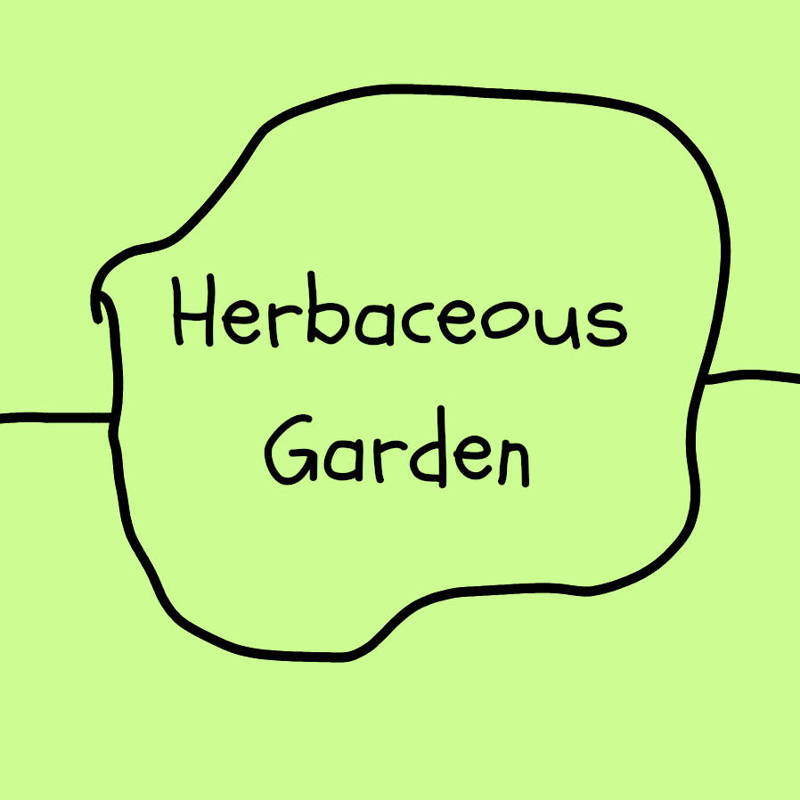
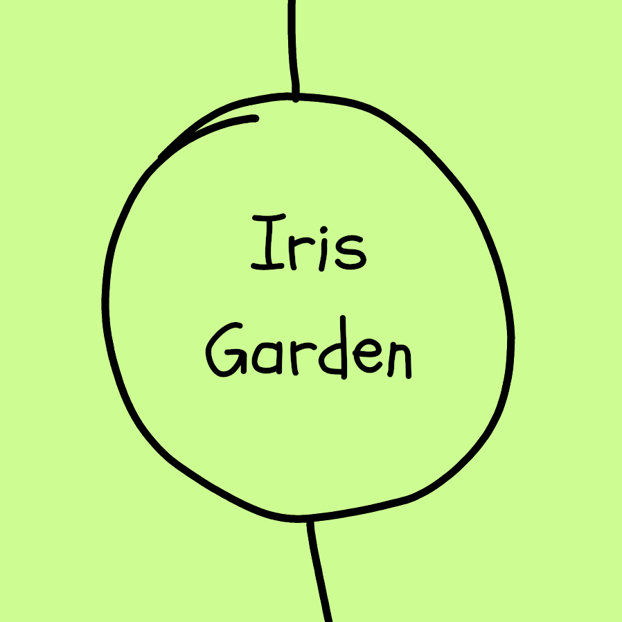
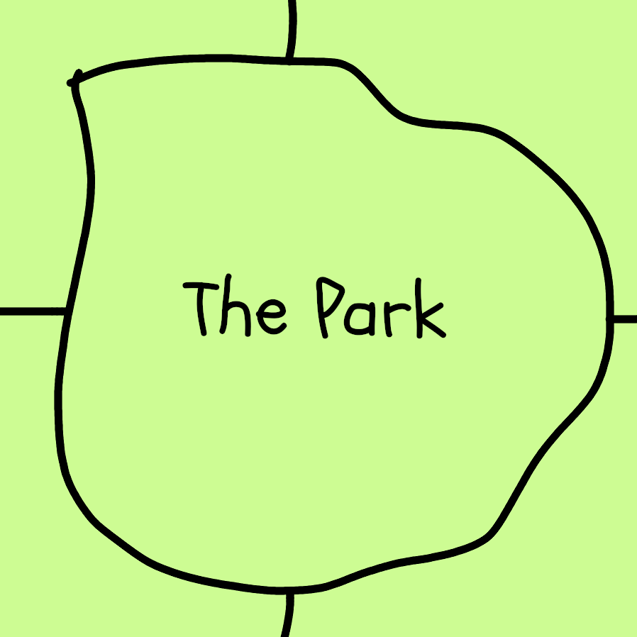
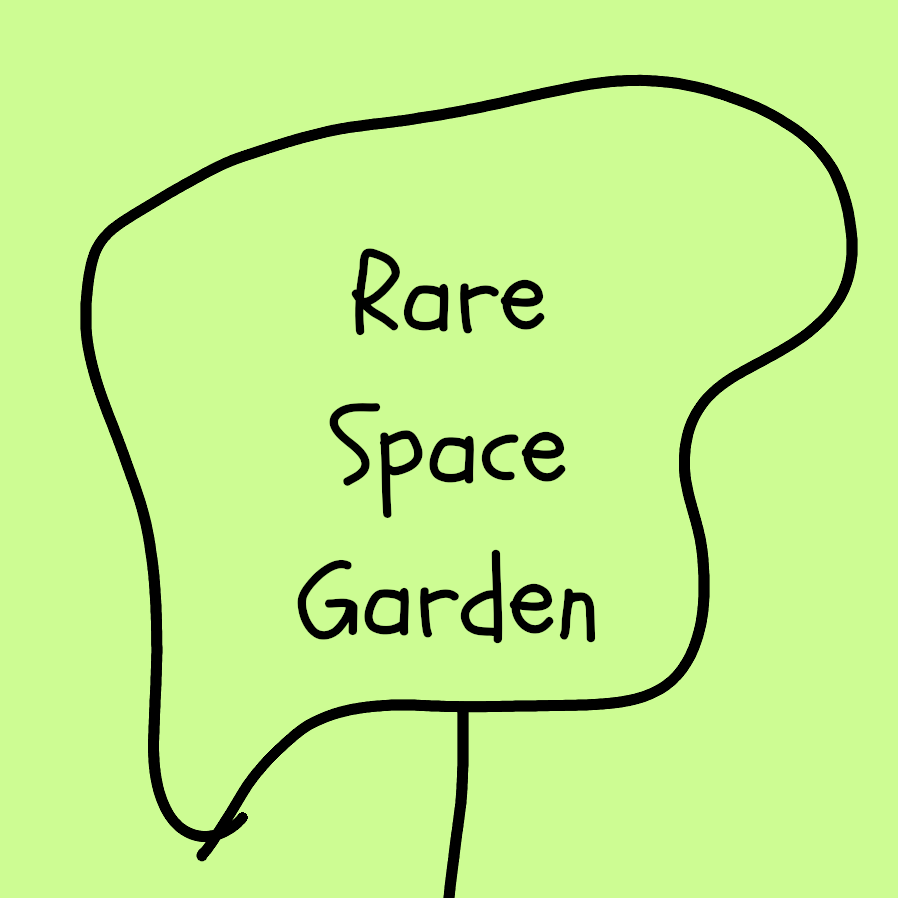
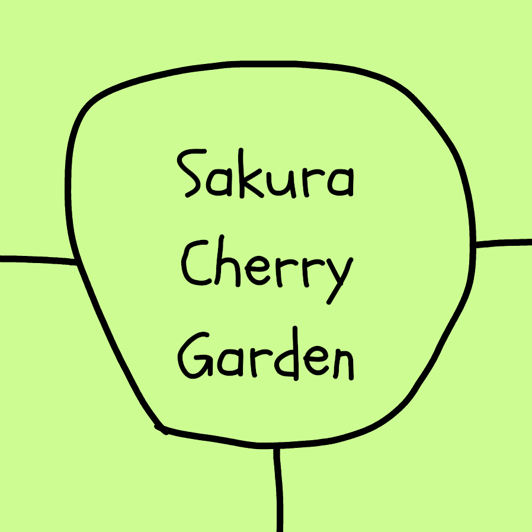
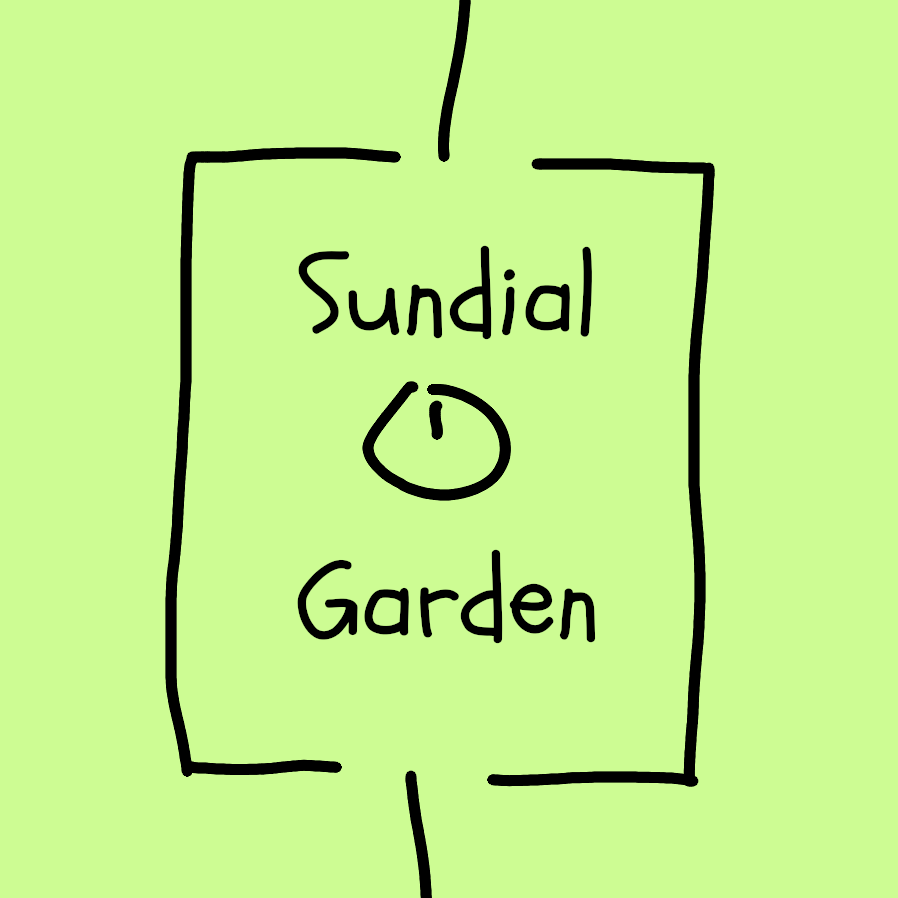
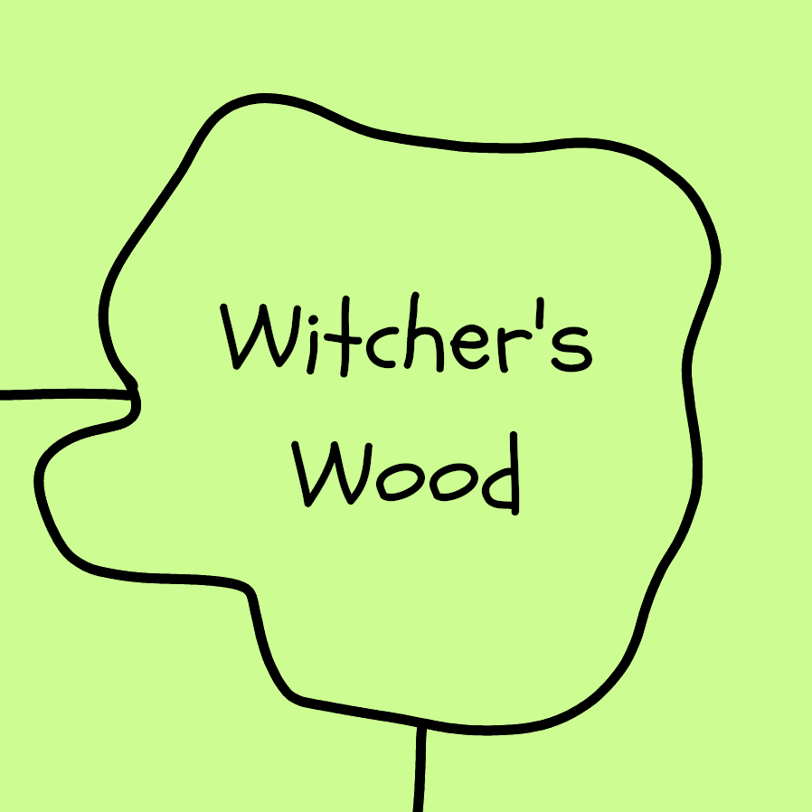

# East locations

The 10 east locations are included within the sticky pool at the start of this [sticky crawl](/sticky_crawl/sticky_crawl.qmd).

The focus of this mystery is on the investigator's interactions with [The Guillotined](/the_toll_of_unmeaning/the_guillotined.qmd). Therefore, the descriptions of the locations are deliberately sparse. The facilitator is free to expand these in prep or during play.

East locations cannot directly connect to [West locations](/the_toll_of_unmeaning/west_locations.qmd). The East and West are only connected by [Gilbury Bridge](/the_toll_of_unmeaning/bridge.qmd).

## (1) Heather Gardens {.h2centre}

Vibrant purple shrubs lie still in the calm.
An enveloping aroma of heather creates a homely vibe.

- Those that rest here heal 1 CTRL (max once). After the rest the investigator can no longer smell any and all heather.

## (2) Herbaceous Garden {.h2centre}

Where there was once herbs, now poppies of red, purple, yellow, and white have conquered the land. The poppies move together as if they share the same dream.

- Those who haphazardly walk through will find themselves falling asleep (STR save to avoid sleep).
- Each and every unattended sleeping investigator will have one of their items stolen by [Rotary Phone Head](/the_toll_of_unmeaning/the_guillotined.qmd#rotary-phone-head) (if alive and activated).

## (3) Iris Garden {.h2centre}

A perfect circular garden of irises.
In the centre the flowers are an all consuming black, made darker by the encircling yellow, orange, and red.

- Slowly the irses will turn to follow the investigators.
- Each investigator will get the strong urge to look at them. Those who do make a CTRL save.
  - Those who failed will have their vision reversed. Their irises will look into their eyes instead of outwards (1d4 dex damage).
  - Vision will mostly return to normal once they leave the iris garden.

## (4) The Park {.h2centre}

{width="500"}

A large open space of grass with scatterings of trees. 
A darkness you've never known before descends from the sky.
No stars, no moon, no light fills the void.

- For those who watch the sky they will hear the sound of a bell come from space.
- It will ring 7 times, each time a new star appears forming a constellation in the shape of a bell. Those who hear all seven rings suffer 1 stress.

## (5) Nursery Glade {.h2centre}

The shrill of a screaming baby reaches out from the centre of the flower nursery.
Its emitter shrouded by the quivering flower buds.

- The source is a fox, its fur replaced by red petals (1d4 stress).
- When approached it will run off screaming whilst leaving a trail of petals.
- If followed it will be found being strangled by [Rotary Phone Head](/the_toll_of_unmeaning/the_guillotined.qmd#rotary-phone-head) (if alive and activated).

## (6) Oxbury House {.h2centre}

A grainy cacophony loudly blares out from the 13th century Manor house. 
A path flanked by [Red bugloss](https://en.wikipedia.org/wiki/Echium_wildpretii) leads to its grand entrance.
These towering tapering plants of thin long succulent leaves transition to a beautiful full covering of small sunset red flowers.
Even now they are covered in ravenous buzzing honey bees.

- How do the investigators intend to traverse the large house?
- The cacophony only becomes louder and more disorienting as it reverberates within its maze like halls.
- The walls are covered with the portraits of bell-headed gentry.
- The massive ballroom on the top floor
  - Chandeliers dangle from the ceiling, potted [Red bugloss](https://en.wikipedia.org/wiki/Echium_wildpretii) line the walls, and massive windows overlook the gardens.
  - [Gramophone Head](/the_toll_of_unmeaning/the_guillotined.qmd#gramophone-head) can be found alone here attempting to drink whiskey and smoke cigars as their gramophone lets out the horrendous dirge.
- [Red bugloss](https://en.wikipedia.org/wiki/Echium_wildpretii) are valued by beekeepers for their high nectar content.

## (7) Rare Space Garden {.h2centre}

Clean geometric flat stones lead a path through this highly manicured garden.
But this all changes in an instant as monstrous [Venus flytraps](https://en.wikipedia.org/wiki/Venus_flytrap) burst greedily from the soils, their taco like heads devouring all other plants.
Crown of lashes and murderous actions make them the new king conquerors of this domain.

- Various posters describe the award winning garden and how it benefits individuals diagnosed with rare dementias.
- [Rotary Phone Head](/the_toll_of_unmeaning/the_guillotined.qmd) sits on a bench waiting in the shadows. With a rustle they will quickly hide when investigators approach.
  - From then on Rotary phone head is activated and will stalk the investigators, attempting to ambush any isolated investigators at other locations.
  - The bench is dedicated to his wife Cherry.
- [Venus flytrap](https://en.wikipedia.org/wiki/Venus_flytrap)
  - Multiple shoots burst greedily from the ground, each topped with a taco like head crowned with lashes of its own flesh.

- [Darwin's slippers](https://en.wikipedia.org/wiki/Calceolaria_uniflora)
  - A low rock bound plant with flowers that look like happy little aliens.
- [Doll's eyes](https://en.wikipedia.org/wiki/Actaea_pachypoda)
  - An ornamental plant with long magenta stems. Perpendicular growths are capped with pure white berries containing a watching black dot.
  - All parts are toxic. Berries contain cardiac toxins that can lead to cardiac arrest and death.

## (8) Sakura Cherry Garden {.h2centre}

A solemn location where cherry blossom petals slowly but constantly fall and rise.
Moonlight showcases the lives and deaths of petal homunculi, falling petal to playful child to burdened parent to withered elder to rising petal before the cycle begins anew.

- As each petal hits the ground it becomes a miniature petal origami human which goes through an entire life within the period of a minute.
- Once the petal human dies it rises back up to the cherry tree as a seemingly normal petal only to go through the cycle once more.
- The first petal taken by an investigator becomes frozen in time becoming a **Frozen petal**. Further petals shrivel and lie still with all its potential taken.

### Frozen petal

Provides 1 stability whilst in a character's inventory. If the character reaches 0 STR the **Frozen petal** disintegrates and the character does not die, instead healing to a total of 1 STR.

## (9) Sundial Garden {.h2centre}

A garden surrounded by large manicured yew hedges. 
Plant beds lay bare and trampled, citron trees plucked of all their fruit.
Dirt flows down the four grassy ramps to the central griffin topped sundial.
It is surrounded by a wreath of flowers, nettles, and the yellow tentacled fruit of the [Buddha's hand citron](https://en.wikipedia.org/wiki/Buddha%27s_hand).

With rashy fragrant dirt-caked hands a calm figure appreciates the scene.
It wears a waistcoat and shirt over its lithe torso and a typewriter above it. 

- Here stands the friendly, and currently relaxed, [Typewriter Head](/the_toll_of_unmeaning/the_guillotined.qmd#typewriter-head).
- The sharp shadow across the sundial shows it to be 7 o'clock. It is unclear where the light comes from.
- [Buddha's hand](https://en.wikipedia.org/wiki/Buddha%27s_hand)
  - A citron tree with thick rinded lemon-like fruit that split into a multitude of tentacles.
  - The fruit is fragrant, containing edible rind and pith but no pulp or juice.

## (10) Witcher’s Wood {.h2centre}

A wood overgrown with thick razor sharp brambles. As you walk the crunching gravel path the sounds of crumbling trees can be heard from within.

- Lone investigators will be ambushed by [Rotary Phone Head](/the_toll_of_unmeaning/the_guillotined.qmd#rotary-phone-head), if activated and alive.
- Investigators must roll a CTRL save or become separated from other investigators.

